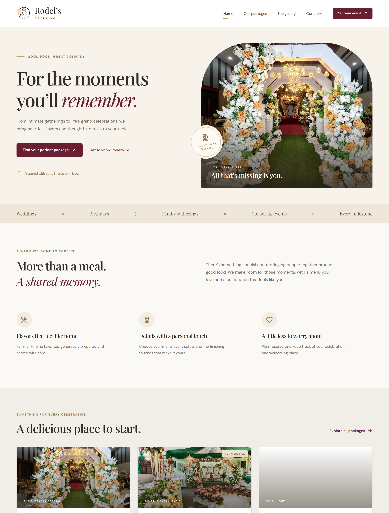

# Rodel's Catering

A full-stack catering reservation and operations website built with React, TypeScript, and Supabase.

Customers can browse packages, plan an event, configure menus and seating, and manage reservations. Staff use separate portals for bookings, inventory, payments, customer management, and reporting.

[Website](https://www.rodelscatering.online) · [Deployment guide](docs/HOSTED_SETUP.md) · [Database contracts](supabase/SCHEMA.md)

## My role

**Project lead and sole software developer — [Julian](https://github.com/Julian-Dev-Web).**

I developed the customer website, staff portals, Supabase database rules and functions, payment integration, reporting, and deployment setup. This repository presents my software implementation within the group project.

## Screenshots



<details>
<summary>View the sign-in screen</summary>


</details>

These existing public-page captures were taken on October 14, 2026. They show the actual unauthenticated interface, without customer or payment records. [Capture provenance](docs/source/screenshot-manifest.json).

## What the system does

- **Customer booking:** package selection, event details, menus, seating, extras, persistent drafts, and reservation review.
- **Staff operations:** customer, manager, and super-admin access; booking review, operating hours, equipment stock, and customer account discounts.
- **Pricing and availability:** database-calculated quotes, inventory and scheduling checks, and stored financial snapshots.
- **Payments:** PayMongo checkout and signed webhook handlers, balance settlement, refund workflows, and payment reporting.
- **Communication:** in-app notifications, optional transactional email reminders, support threads, feedback, and a server-backed public assistant.
- **Reports and administration:** filtered reports, CSV/PDF export, gallery management, audit logs, and application-data export.

Provider settlement, refunds, email delivery, and real business settings require their own configured environment and acceptance checks. Source implementation is not a claim that every live provider flow has completed acceptance.

## Technology

| Layer | Tools |
| --- | --- |
| Frontend | React 19, TypeScript, Vite, React Router |
| Forms and data | React Hook Form, Zod, TanStack Query |
| Backend | Supabase Auth, PostgreSQL, Storage, Realtime, Edge Functions |
| Integrations | PayMongo, optional Resend email, Groq-backed assistant |
| Reporting | Recharts, jsPDF, CSV and print export |
| Validation | Vitest, PGlite, TypeScript, ESLint |

## Run locally

```sh
npm ci
```

Copy `.env.example` to `.env` and supply your own Supabase URL and public anon/publishable key:

```dotenv
VITE_SUPABASE_URL=https://YOUR_PROJECT_REF.supabase.co
VITE_SUPABASE_ANON_KEY=YOUR_PUBLIC_ANON_OR_PUBLISHABLE_KEY
```

```sh
npm run dev
```

The frontend requires the matching Supabase schema and functions. Follow the [hosted setup guide](docs/HOSTED_SETUP.md) for a new environment, and review the current migration files before making backend changes. Existing installations must use the appropriate incremental updates rather than rerunning the fresh-project installer.

Server credentials for payment providers, email, and AI belong in Edge Function secrets. Local environment files and server secrets must not be committed or exposed through `VITE_*` variables.

## Development checks

```sh
npm run typecheck
npm run lint
npm test
npm run build
```

Tests include local database checks; these do not require real customer or payment records. [Hosted acceptance checklist](QA_CHECKLIST.md) explains the separate deployment checks.

## Explore the implementation

| Path | Purpose |
| --- | --- |
| `src/pages/` | Public, customer, manager, and system administration screens |
| `src/features/` | Booking, catalog, authentication, and business workflows |
| `supabase/migrations/` | Database schema, authorization, pricing, and booking rules |
| `supabase/functions/` | Payment, assistant, email, and administrative endpoints |
| `tests/` | Application and database regression coverage |
| `docs/` | Architecture, screenshots, implementation notes, and handoffs |

The former README's detailed setup instructions and dated implementation history are preserved in [docs/HOSTED_SETUP.md](docs/HOSTED_SETUP.md). Historical deployment notes describe their original verification dates.
