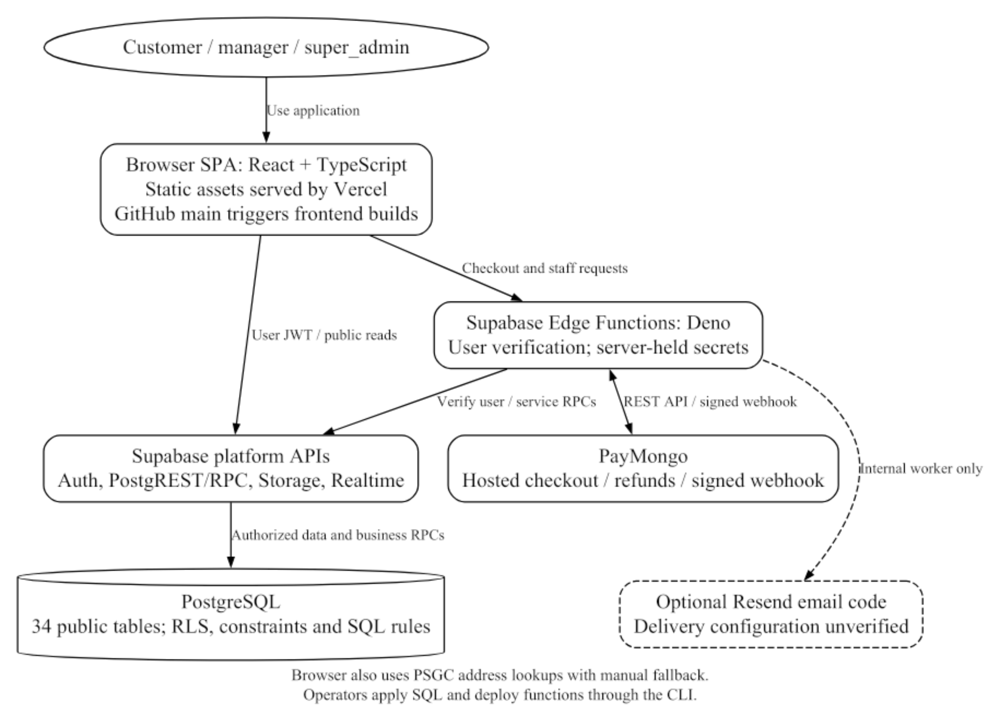
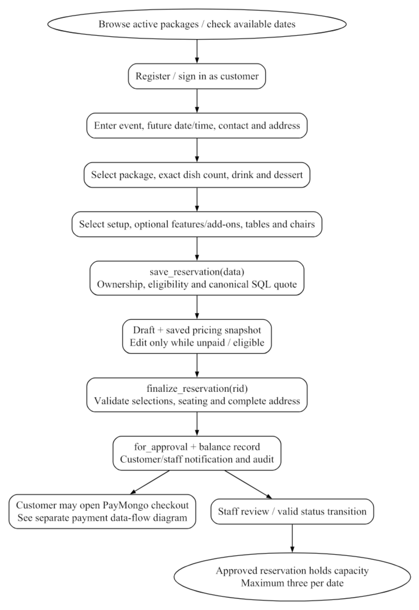
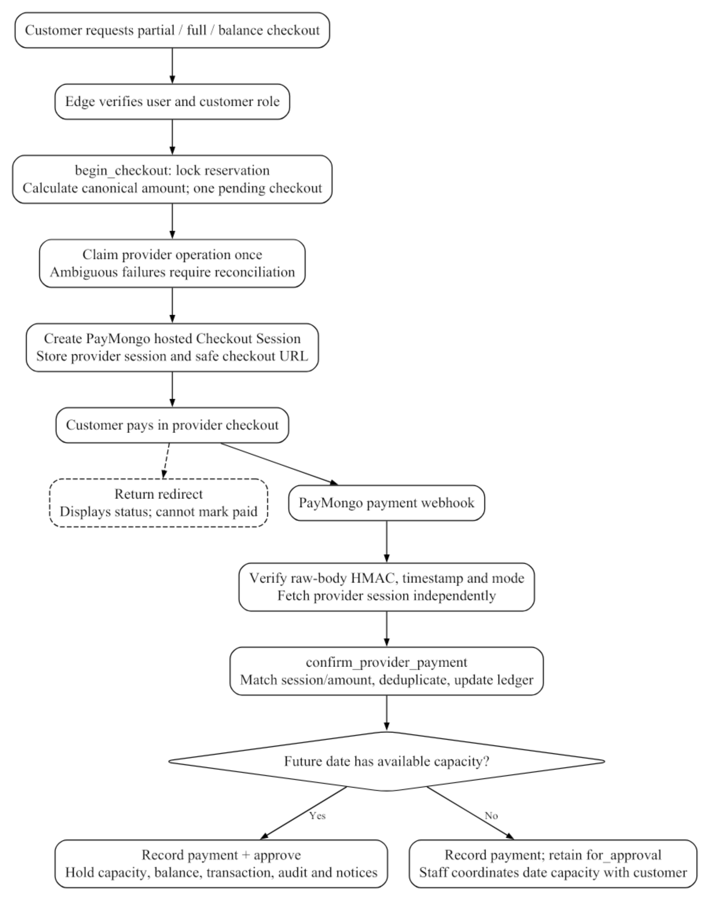
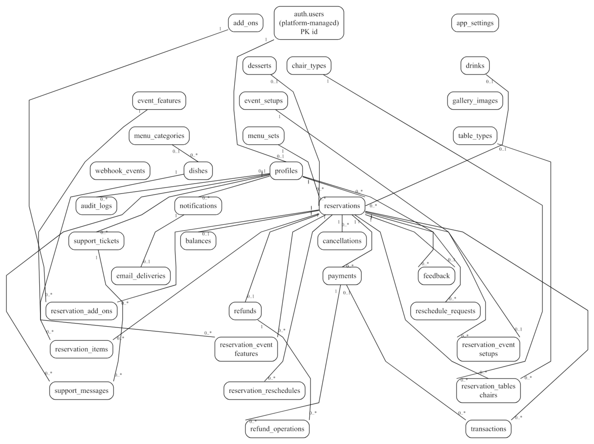
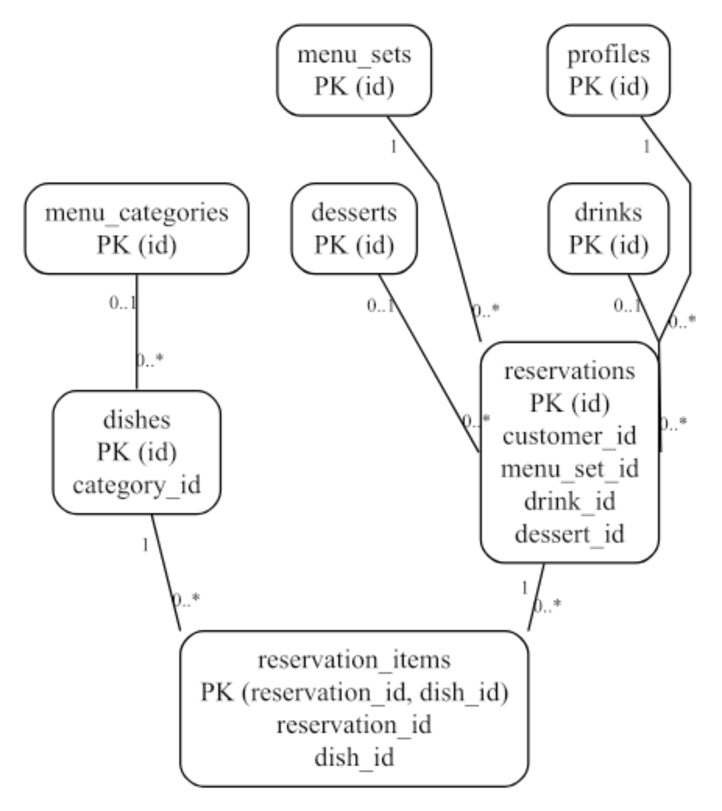
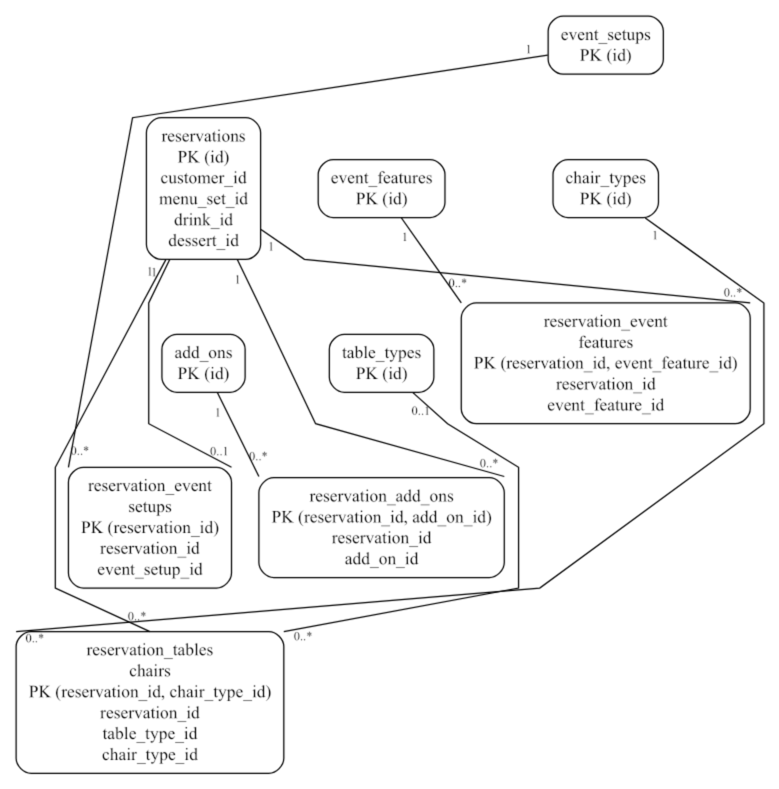
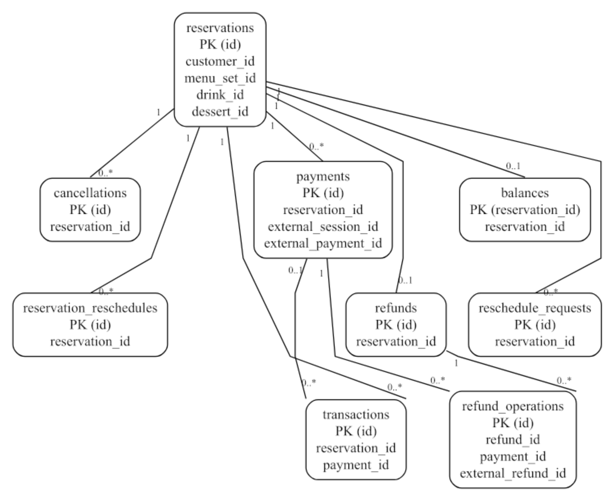
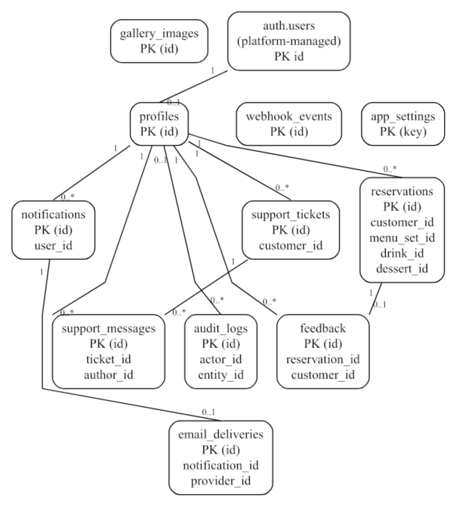
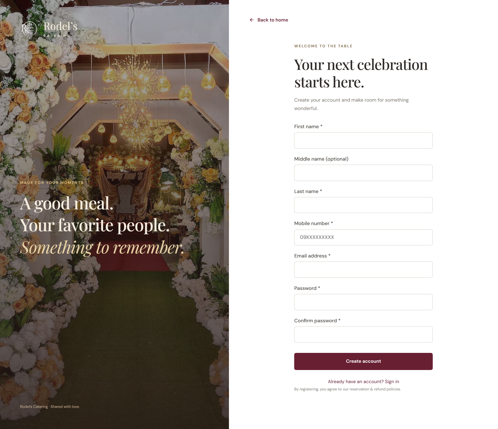
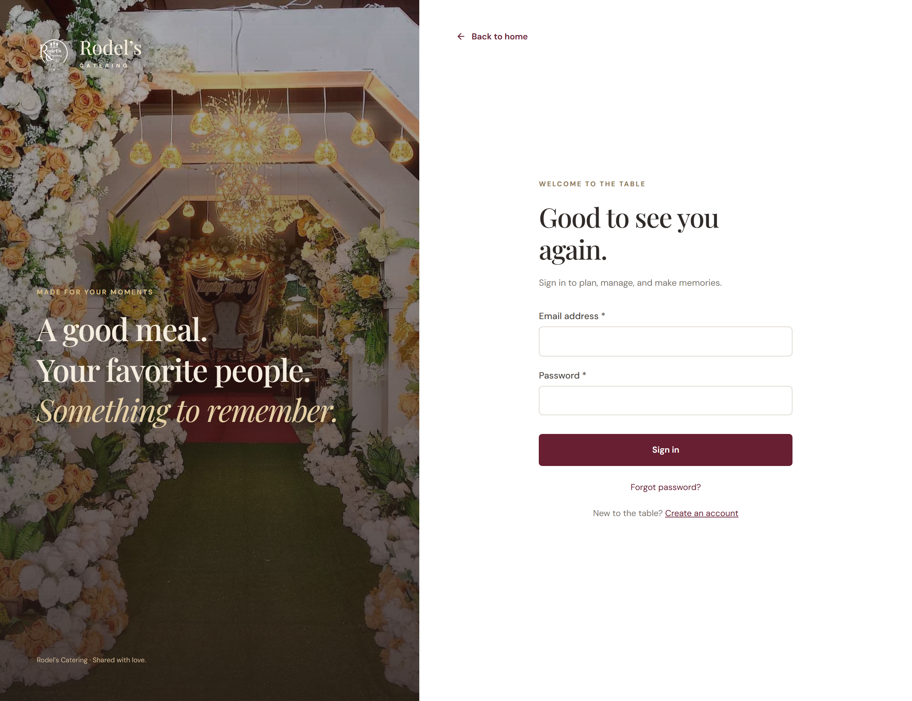

# CHAPTER 1 — PROJECT OVERVIEW

## 1.1 Business Objectives

RodelConnect is the current web reservation application for Rodel's Catering Services. It centralizes package selection, event details, scheduling, quotes, workflow requests and service communication in a React interface backed by Supabase. The business context presented in the existing About page identifies San Ildefonso, Bulacan as the operating location. This paper documents the inspected implementation rather than a fictional proposed PHP system. [1]

The objectives are accessible browser booking, consistent date/selection/pricing rules, organized staff review and linked payment records. These are supported design objectives; sales improvement, processing-time reductions and adoption outcomes have not been measured. No survey or operational performance dataset was supplied.

The official title retains “with Integrated Chatbot” as provided. The current build has no chatbot widget, provider/model, endpoint or conversation schema. Chatbot assistance anticipated in the earlier background remains planned scope, not a completed feature. [1], [3]

## 1.2 Target Audience

Customers include individuals, families, organizations and businesses arranging catered occasions such as birthdays, weddings and corporate gatherings. Public visitors may browse packages, the gallery and policies without an account. Authenticated reservation users have the database role customer; “guest” is not a separate stored role. Customers create and track their own bookings, open eligible payment sessions, submit requests and communicate through private support threads. [1]

Managers review reservations and workflow requests, maintain categories/dishes/drinks/desserts, and read payments/reports, feedback and support. super_admin additionally manages packages/priced extras, gallery, permitted role assignments, maintenance and audit logs, and may enter manager routes. Staff cannot use customer booking routes. First super-admin creation requires an operator workflow; registration cannot select a privileged role.

## 1.3 Problem Statement

The earlier Chapters 1–2 document described manual and fragmented reservation coordination, difficulty checking availability, and inconsistent tracking of payments and request changes. These statements are treated as the historical motivation supplied by the project team. They are not asserted as newly measured conditions, and no invented customer count, consultation date, defense comment or test statistic is added. [3]

The technical problem addressed by the current implementation is maintaining a consistent reservation state when customers and staff perform different actions. A browser quote must not override authoritative prices; concurrent approvals must not exceed date capacity; a payment return link must not create a paid record; and one customer must not obtain another customer's booking or support data. Current SQL constraints, protected functions, Row Level Security and server-side provider verification address these concerns. [1]

## 1.4 Project Scope

Implemented customer functions include structured registration, email/password sign-in, recovery-page handling, profile/avatar editing, package and available-date browsing, a multi-step reservation wizard, saved quotes, finalization, reservation detail, down-payment/full/balance checkout, cancellation and reschedule requests, refund requests, payment/transaction views, completed-reservation feedback and support. Manager and super-admin screens implement the operational scopes described in Section 1.2. [1]

The reservation rules require an event at least three Manila calendar days ahead, an event time between 07:00 and 22:00, package minimum guests, the exact package dish count, an active drink/dessert/setup, a complete event address, sufficient active chairs and at least one table. A unique index prevents a second active reservation for the same customer and date. Capacity is held by approved/completed bookings and retained during pending cancellation, with a maximum of three per date.

Verification covered 35 local checks plus hosted login, reservation APIs, test checkout, unsigned webhook rejection and recovery. Paid/refund completion, inbox delivery, full browser/concurrency, Storage and Realtime acceptance remain pending. Chatbot, SMS/OTP, courier, privacy portal, compliant invoices, tax automation, restore verification and CI gates remain incomplete. Business seeds need review; legacy import is unverified. [1]

# CHAPTER 2 — SYSTEM ARCHITECTURE

## 2.1 Architectural Pattern

The current application uses a client–managed-service–serverless architecture. Vercel serves a static Vite build of a browser React single-page application. Supabase provides Auth, a PostgreSQL Data API, Storage, Realtime and Deno Edge Functions. Browser users perform policy-controlled data reads and permitted catalog/profile writes, while business transitions use SQL RPCs and provider-sensitive operations use Edge Functions. This is a layered architecture, but its application logic is deliberately shared between SQL functions and serverless handlers rather than a standalone PHP application server. [1], [7], [12]

The frontend is not implemented as server-side rendering, and the repository does not contain a current PHP/MySQL runtime or a microservice fleet. The legacy PHP application remains historical background. The development laptop may run Vite locally against the hosted Supabase project; another user needs only the deployed browser URL, not XAMPP or a local database.

## 2.2 System Layers

Presentation layer. React pages and shared layouts provide public content, authentication and three role workspaces. React Router defines routes; React Hook Form and Zod validate forms; TanStack Query handles cached queries and refreshes; Recharts visualizes derived staff metrics. src/features/auth.tsx supplies session/profile state and RoleGuard, but browser guards are only the user-experience layer of authorization. [1], [4]–[6]

Application layer. SQL routines enforce ownership, prices, reservation state transitions, capacity, cancellation/rescheduling rules and refund eligibility. Edge Functions verify callers with auth.getUser(), retain provider secrets on the server and handle PayMongo REST requests and webhook verification. The optional email worker derives its recipient and content from an existing notification rather than accepting arbitrary browser email requests.

Data layer. PostgreSQL stores 34 public domain tables and their constraints; all have RLS enabled in the inspected migration execution. auth.users is a platform-managed identity source, linked one-to-one at most to profiles. Storage contains avatar/gallery objects, while Realtime publishes notification changes. Monetary values are bigint centavos; event dates/times follow Manila-local rules and timestamps are timestamptz. [1], [9]–[11]

## 2.3 Data Flow

1. The customer browses active packages and queries available_dates over a bounded date range. Registration sends first name, optional middle name, last name and mobile contact to Supabase Auth metadata. The Auth trigger creates a profile with customer role regardless of submitted role metadata. Login obtains a session and loads the profile before selecting the role workspace.

2. The reservation wizard collects event/address/contact details, package/menu selections, setup, features, add-ons and seating. save_reservation locks an existing eligible booking or creates an owned draft, replaces selected child rows and recalculates the quote in SQL. Supplied browser totals are not authoritative. Editing is blocked after payment, approval or while an open checkout requires reconciliation.

3. finalize_reservation validates complete active selections and the event address, stores the server quote, moves the booking to for_approval, records the current balance and writes notices/audit data. Staff may review a valid future booking. Capacity checks occur when a transition actually holds capacity, not merely when a customer saves a draft.

4. An authenticated customer requests a payment intent through create-paymongo-checkout. begin_checkout locks the reservation and determines 50% down payment, full initial payment or the outstanding balance. A conditional provider claim prevents duplicate session creation. The Edge Function creates a PayMongo Checkout Session and stores its identifier and validated HTTPS checkout URL. The customer enters payment information on the provider page, not in this application. [1], [14]

5. A return URL only reloads the reservation. Payment confirmation requires the checkout_session.payment.paid webhook, valid raw-body HMAC/timestamp/mode, an independent provider session lookup and a matching amount/session in confirm_provider_payment. That transaction deduplicates events, records the payment, updates balances and inserts a ledger transaction. If future-date capacity remains available, the reservation can be approved; otherwise the payment is retained and staff must coordinate capacity with the customer. [1], [15]

6. A customer cancellation request is reviewed by staff. An approved cancellation releases held capacity and zeroes the current payable balance. Eligible paid bookings may request a refund; the amount is frozen using the configured policy. Approved refunds are allocated across original payments, claimed once and checked against provider results. finish_refund completes local state only after the full eligible amount is confirmed successful. Rescheduling similarly requires staff review, date capacity and the monthly successful-reschedule limit.

## 2.4 Architecture Diagram

Figure 2.1 distinguishes the browser, Supabase APIs/database and server-side provider boundary. The optional Resend connection is drawn as optional code, and the PSGC lookup/operator deployment are identified in the diagram note. Figures 2.2 and 2.3 separate reservation entry from payment verification so that no return redirect is mistaken for proof of payment.

Derived from the current router, Supabase client, Edge Functions and deployment configuration. Provider credentials stay in server configuration.

Draft entry, saved pricing and finalization are separate operations. A saved draft does not itself reserve one of the three approved slots.

The diagram shows implemented confirmation logic; successful paid provider delivery remains an acceptance item. The dashed return path cannot confirm payment.

# CHAPTER 3 — TECHNOLOGY STACK

Table 3.1 lists technologies found in the current source and lockfile. The reasons are implementation-based technical justifications, not invented historical team decisions. Exact JavaScript package versions are taken from the inspected lockfile; package.json ranges alone do not establish the installed version. Supabase is managed PostgreSQL, but the hosted PostgreSQL engine version was not queried for this document. [1]

Table 3.1. Verified technology stack and technical justification.

# CHAPTER 4 — KEY API INTEGRATIONS

## 4.1 Payment Gateway

PayMongo is the implemented payment provider. create-paymongo-checkout calls the Checkout Sessions REST endpoint and requests GCash and card payment methods; actual availability depends on the merchant account. The configured integration uses PHP currency and test-mode credentials in the recorded setup. A hosted test checkout was successfully created through the customer session. No real payment amount, provider reference, checkout token or customer transaction is reproduced in this paper. [1], [14]

The webhook subscribes to checkout_session.payment.paid. The handler verifies Paymongo-Signature using raw-body SHA-256 HMAC, the matching test/live signature field and a five-minute timestamp window. It independently retrieves provider state and only submits a matching paid PHP payment to the restricted SQL confirmation function. A deployed unsigned request returned HTTP 401. Successful paid delivery and duplicate-delivery acceptance remain pending despite local SQL/signature tests passing. [1], [15]

Refund requests originate from an approved cancellation and a valid paid amount. Seeded policy defaults are 30% of an exact 50% down payment or 70% of a fully paid amount; super-admin settings may change these values, and stored eligibility remains fixed for an existing request. The deployed refund handler supports allocation, provider submission/status lookup and completion checks. Provider refund completion has not been verified. These technical defaults need business approval and legal review before customer use.

## 4.2 Logistics & Shipping

A courier shipping integration is not applicable to the inspected event-service reservation scope. The application coordinates an event date/time, venue address, guest count, setup and seating selections. It does not create shipping labels, courier tracking numbers, delivery-rate quotations, rider assignments or a separate logistics inventory. Event coordination must not be described as a J&T, LBC, Lalamove or other provider integration without code evidence. [1]

## 4.3 Notifications (SMS/Email)

In-app notifications are implemented as recipient-linked database rows. SQL routines notify customers and staff after relevant transitions. PortalLayout subscribes to the notifications Realtime publication and also refetches every 60 seconds. Read/unread state is restricted to the recipient. Real hosted subscription/delivery acceptance remains pending. [1], [11]

Supabase Auth handles verification and password-recovery requests. Backend recovery, password replacement and the live redirect were tested without sending email to the test identities. Inbox delivery was not verified. Supabase default SMTP restricts delivery to project-team recipients; custom SMTP is needed for general users and production mail. Mobile contact collection does not implement SMS or phone OTP. [8], [13], [25]

Optional transactional email code uses Resend through send-transactional-email and an internal dispatch script. It derives addresses from persisted users/notifications, uses a worker secret and an idempotency key, and records deliveries. The function is deployed, but configured Resend credentials, a scheduled worker and received messages are not verified. Optional email must therefore be presented as partially configured code rather than a working general notification service. [1], [16]

## 4.4 Integrated Chatbot — Planned Feature

The current source has no chatbot widget, endpoint, provider/model, knowledge base or conversation schema. Support is human staff/customer messaging. The official title is retained, but chatbot integration is planned and must not be presented as completed functionality or added to the current ERD/screenshots. [1]

Future chatbot work requires a provider decision, server-held credentials, approved knowledge sources, privacy/retention controls, human fallback and evaluation. No brand/model is assumed.

## 4.5 Geographic Address Lookup

The wizard uses the public PSGC API for province/city/barangay lookup through src/services/psgc.ts, with validated cached results, request timeout and manual fallback. This does not establish courier tracking or official venue validation. [1], [19]

# CHAPTER 5 — DATABASE SCHEMA

## 5.1 Core Entities

The inspected migrations define 34 public tables and 35 foreign-key constraints. An isolated PostgreSQL/PGlite execution generated the schema manifest used for the dictionary and ERDs. Its Auth/Storage scaffolding is a test substitute; it is not a copy of hosted customer data. The diagram includes auth.users only as a platform-managed parent, not an application-owned users table. app_role and workflow states are enum types, not separate role/status entities. [1], [18]

Most primary keys are UUIDs; app_settings.key and webhook_events.id are text, while selection tables use composite keys. The event address and pricing breakdown are JSONB within reservations rather than invented separate address/quote tables. Monetary amounts are bigint centavos. The API reserves direct financial/state writes for controlled SQL/server operations, and the read scopes below are derived from actual grants and RLS policies.

In Table 5.1, “staff” means manager or super_admin; “owner” means the authenticated customer owning the parent reservation/ticket. “Service-only” means no direct customer/staff RLS policy exists. Public catalog access is limited to active content outside maintenance, with staff visibility according to the actual policy. Catalog writes and operational transitions have different role restrictions. A public Storage URL does not make private reservation/customer tables publicly readable.

Table 5.1. Actual public domain entities, keys and access scopes.

## 5.2 Entity-Relationship Diagram

Figure 5.1 is the complete source-derived FK overview. Figures 5.2–5.5 provide detailed domain views for print readability; repeated parent tables are context, not duplicate entities. Relationship-end labels use 1, 0..1 and 0..* to denote mandatory single parent, optional single parent and optional many children. These multiplicities follow column nullability and unique/primary-key constraints; business rules may be stricter at finalization.

For example, a profile references exactly one Auth user, while an Auth user has at most one public profile by schema. A reservation has one required customer and menu set; drink/dessert references are nullable at the draft schema level even though finalization requires them. Balances, the selected setup, feedback and refunds have unique reservation links and therefore at most one row per booking. Payment references in transactions and audit actor links are nullable. No chatbot entity or courier entity is invented.

gallery_images, app_settings and webhook_events have no domain FK relation; they remain visible as real standalone tables in the relevant view. The schema does not declare a FK from profile.avatar_path to storage.objects. Storage object access is governed by bucket/path policies, so the ERD does not fabricate that relationship. A full-resolution ERD PNG is delivered separately for zooming or larger-format printing.

All 34 public tables and the external auth.users identity parent are included. Use the detailed panels and source PNG for field/cardinality inspection.

Nullable draft drink/dessert/category links are distinguished from required package/customer links.

Selection bridges use real composite/unique keys. table_type_id remains nullable in the DDL; finalization applies additional seating checks.

One balance/refund per reservation differs from multiple payments, transactions or reschedule history rows. Refund allocations link original payments.

Notification email delivery is unique per notification. The standalone gallery/settings/webhook-event tables are retained without invented links.

# CHAPTER 6 — SECURITY & LEGAL COMPLIANCE

## 6.1 Technical Security Measures

Authentication is handled by Supabase Auth; the application does not create its own password hashing or browser-based password database. Registration metadata supplies contact/name data but cannot choose a privileged profile role. RoleGuard and roleHome direct the interface, while RLS, column-level grants and protected SQL functions provide authoritative access restrictions. The client requires matching passwords and at least eight characters; the hosted Auth password policy still needs configuration review. [1], [8], [9]

All inspected public domain tables enable RLS. Customers read only permitted owned reservations, financial records and support threads; staff visibility and super-admin catalog/audit operations follow their policies. SECURITY DEFINER routines use an empty search_path with qualified objects, require the appropriate actor and explicitly restrict execute privileges. Private helper access is revoked. Reservation capacity uses transaction advisory locks, and provider event/session/reference uniqueness protects against duplicate local financial records.

Frontend configuration contains a public project URL/key, not a provider or service-role secret. Provider secrets are deployed only to the server environment. Even with gateway verify_jwt=false, user-facing Edge handlers call auth.getUser(); the unauthenticated payment webhook uses signature verification, and the email worker uses its own secret. Exact-origin CORS is implemented for browser-invoked handlers. An unsigned hosted webhook was rejected in the recorded test. These checks do not make CORS a substitute for authorization. [1], [26]

SQL constraints and RPC validation enforce data integrity beyond form checks. React escapes ordinary rendered text; the source does not implement arbitrary SQL input or an HTML content editor. CSV export neutralizes formula-leading characters. Avatar/gallery uploads enforce allowed JPEG/PNG/WebP types and size limits, with owner-folder/super-admin write policies. Both image buckets are public, so they must not be used for sensitive customer documents or payment proofs.

Session persistence uses the browser SDK storage mechanism; this is not an HttpOnly-cookie authentication implementation. XSS prevention therefore remains important, and the current Vercel headers do not establish a full Content Security Policy. No app-level MFA, dedicated abuse-rate-limit layer, proven vulnerability scan or independent penetration test is documented. A stronger CSP, appropriate authentication/rate controls, dependency review and credential rotation are recommended actions, not features claimed as complete. [1], [24]

## 6.2 Legal & Regulatory Compliance

Republic Act No. 10173 requires lawful and accountable handling of personal information. RodelConnect collects names, contact information, event addresses, support messages and feedback; access controls help protect those records but do not alone establish compliance. The inspected build lacks a dedicated privacy notice/rights-request portal, verified retention/deletion schedule and documented legal/privacy review. The business must determine purposes, lawful bases, appropriate notices, rights-handling and provider responsibilities before general customer use. No compliance certification is issued by this technical audit. [20]

Republic Act No. 11967 is relevant to Philippine internet transactions within its scope, including online service transactions. The application displays business/contact and reservation/refund information, but there is no evidence here of validated registrations, a complete statutory disclosure review or formal complaint-resolution/legal approval. The business should assess applicable online-merchant duties and ensure service terms, cancellation/refund decisions and consumer redress are lawful and clear. Courier rules are not invented for an event-service workflow, and a configured refund percentage is not proof of consumer-law compliance. [21]

BIR invoicing considerations require accounting review of the business and its authorized documents. The application stores ledger transactions and can export reports; PayMongo may send a provider payment receipt. These are payment records and do not establish that the system issues BIR-compliant invoices. No verified invoice registration, prescribed sequential issuance, tax computation or compliant electronic-invoice integration is found. Current invoicing obligations and subsequent applicable issuances must be assessed by the business/accountant; the paper does not certify tax compliance. [22]

# CHAPTER 7 — DEPLOYMENT & CI/CD

## 7.1 Development Workflow

The inspected source is in the rodels-catering GitHub repository under Julian-Dev-Web. main is the observed branch, and the setup record includes initial source, structured registration/recovery and verification-record commits. No sustained feature-branch, pull-request approval or branch-protection practice was verified. Recommended future review branches are therefore not described as an already adopted team workflow. [1]

Developers use the tracked package lock and npm scripts for lint, TypeScript, local tests and the production Vite build. The latest recorded suite contains 35 automated checks across rules, account input/recovery handling and actual PostgreSQL business/security logic with test scaffolding. These are checks, not participants or a user-acceptance score. Source/version and artifact details are recorded in the supporting evidence audit.

## 7.2 CI/CD Pipeline

The actual frontend path is GitHub main push → Vercel install/build → static deployment. The Vercel integration and updated entry bundle were observed in the setup session, and https://rodels-catering.vercel.app is the verified browser endpoint. Vercel uses npm ci, npm run build and dist; vercel.json supplies SPA rewrites and security headers for nested routes. VITE_SUPABASE_URL and VITE_SUPABASE_ANON_KEY are public client configuration values set in hosting, with their values omitted here. [1], [17]

The current build script runs TypeScript and Vite, not npm test or ESLint. No GitHub Actions workflow was found. Tests were run locally before pushes; an enforced automated test gate is proposed rather than implemented. Supabase SQL migrations, server secrets and five Edge Functions are applied/deployed separately by the operator with the CLI. No Docker, PM2, custom Nginx/Apache process, containerized release pipeline or simultaneous frontend/database rollback is claimed.

The fresh-project SQL bundle runs migrations in one transaction and refuses an existing public schema. An existing installation applies the standalone profile update; rerunning the full setup is not an upgrade strategy. Because earlier SQL Editor installation did not register CLI history, operators must review and baseline migration history before using db push. Provider/server secrets and private test credentials are excluded from Git. Separate environment and release review remain necessary.

## 7.3 Server Management & Monitoring

Vercel and Supabase manage the hosting/runtime infrastructure. The application supplies frontend error/loading states, protected financial transitions and audit records, while platform logs can support build, Auth and Edge Function investigation. A dedicated Sentry integration, configured alert schedule, health dashboard and log-retention review were not found in the repository. Audit logs document domain actions and are not a replacement for full operational/security telemetry. [1]

SECURITY_NOTES.md describes ambiguous checkout/refund reconciliation and recovery precautions. Operators must inspect actual provider state before releasing an ambiguous claim or retrying a money movement; local expiry does not prove a provider session is unpaid. Documentation also calls for backups and an isolated restoration exercise. Supabase backup availability depends on the project plan, and database backup does not replace backup of Storage object files. No executed restore test or retention policy is certified here. [1], [23]

Before real customer operation, the team must finish paid-webhook/refund tests, real inbox and role-browser acceptance, Storage/Realtime checks, concurrent scheduling tests, catalog/policy approval, secret rotation and privacy/accounting review. The reconstructed action matrix in Appendix D records implementation improvements without inventing previous panel comments or official proceedings.

# APPENDIX A — USER MANUAL / GUIDE

## A.1 Access, registration and recovery

Open https://rodels-catering.vercel.app in a current browser. Public visitors can browse Home, Packages, Gallery, About and Policies. A visitor does not need a guest account merely to browse. Use Register to create a customer account; privileged staff access is assigned through an authorized operator/super-admin workflow, never selected in the registration form.

Enter first name, optional middle name, last name, Philippine mobile contact, email, password and matching confirmation. The form normalizes mobile contact and validates required fields. Follow any email-confirmation instructions returned by Supabase, then sign in using email and password. Registration supplies a customer profile; a phone field does not imply SMS verification.

For recovery, select Forgot password on the login page, enter the account email and submit. Open the newest valid recovery email link; the app routes recovery sessions to /reset-password. Enter and confirm the replacement password. If the link is expired or invalid, request a new one. The implementation and recovery API/redirect have been verified, but the intended mailbox delivery and complete browser journey still need acceptance testing. [1], [8], [25]

Figures A.1 and A.2 are actual unauthenticated production-host screenshots captured for this document. Form fields are blank. No invented dashboard, customer identity, transaction or payment-success screenshot is included.

Captured from /register on October 14, 2026. First name, optional middle name, last name, mobile contact and password confirmation are visible.

Captured from /login on October 14, 2026. The recovery link leads to the implemented password-reset request page.

## A.2 Customer reservation and service tasks

1. After customer sign-in, use Available Dates and Packages to choose an eligible date and package. Available date capacity describes approved/completed bookings; saving a draft does not hold a slot. Dates must be at least three Manila calendar days ahead, and the package minimum guest count applies.

2. Open Reservations → New reservation. Enter event name, date, permitted time, guest count, mobile contact and the full venue address. Select province/city/barangay through the geographic lookup where available, or use the manual fallback. Select the package, its exact dish count, a drink and dessert; then select the event setup, optional extras, tables and enough chairs.

3. Save to obtain a server-calculated draft quote. Review all selections and finalize only when the event details are complete. Finalization creates a for_approval record and balance. An unpaid eligible draft may be edited; paid/approved records and bookings with unreconciled checkout attempts cannot be freely rewritten.

4. Open the reservation detail and select the offered down-payment, full-payment or balance intent. Follow the external PayMongo checkout URL. Card/GCash availability is subject to the provider account and mode. After returning, inspect the recorded status; a return page alone does not confirm payment. A signed, server-verified provider event is required. Use test mode for acceptance; real settlement/refund has not been certified here.

5. Request cancellation with a reason while the booking is eligible and more than 72 hours before the Manila-local beginning of the event date. Staff reviews the request. An approved cancellation may support a refund request according to the frozen policy calculation; staff approval is separate from provider completion. Do not assume every payment is fully refundable.

6. For an approved future booking, request a new date at least three days ahead with a reason. Staff reviews capacity and the limit of three successful reschedules per booking per Manila calendar month. After a fully paid event is marked completed, submit feedback. Use Support to create a ticket or reply until it is closed; use Settings for profile/avatar/password changes. [1]

## A.3 Manager operations

Sign in with an authorized manager identity and use /manager/dashboard. Review /manager/reservations and the detail/action controls before approval or rejection. Valid approvals must concern finalized future bookings with capacity; rejection is restricted to eligible unpaid records. Mark completed only when an approved event is due/past and the total is paid. Server errors explain ineligible transitions rather than allowing arbitrary status edits.

Use /manager/menu for categories, dishes, drinks and desserts; the manager does not obtain the super-admin price/catalog scope. Review cancellations, reschedules and refunds in their corresponding manager pages. Refund approval only authorizes processing; the process-refund function and provider success determine completion. If a provider claim is ambiguous, escalate for reconciliation rather than repeatedly initiating a money movement.

Use Payments, Feedback and Support for permitted operational records. Reply to a support ticket or resolve it when appropriate. Reports and dashboard metrics summarize recorded data; no fabricated sales history is part of the seed. Authenticated staff screenshots and end-to-end role acceptance are pending, so this guide is based on the current routes and source behavior. [1]

## A.4 Super-admin operations

Sign in with an operator-established super_admin identity and use /super-admin/dashboard. Manage packages, priced extras/seating, gallery records and uploads, users, maintenance and audit logs through the dedicated routes. The super-admin can enter manager routes for operational reviews. Changes to catalog prices must be reviewed against the business offering; stored finalized/pricing and payment rules remain server controlled.

In Users, assign only the allowed customer/manager roles to eligible other users. The role function rejects self-assignment, assignment of super_admin and modification of an existing super-admin. Use the operator-managed workflow for first/admin identity changes. Maintenance affects public/customer access; review its consequences before enabling it. Audit records can be read but are not a normal editable log. [1]

## A.5 Operator setup and acceptance checklist

For a new project, install the locked dependencies, configure the public frontend project URL/key and run the complete generated setup bundle only against an empty public schema. For an existing installation, review/apply incremental SQL instead. Never expose a service-role or provider secret through a VITE_ variable. Configure Auth site/redirect URLs to the correct frontend origin and recovery path.

Deploy the five Edge Functions and server environment separately. Configure PayMongo test credentials and the enabled checkout_session.payment.paid webhook using the deployed paymongo-webhook endpoint. Verify provider mode, APP_URL, caller verification and signature handling. Optional transactional email also needs Resend/from-address/worker credentials and a scheduled caller; code deployment alone does not establish delivery.

Run local lint/type/build/tests, then verify real inbox recovery, role browser isolation, customer finalization, test payment webhook completion/replay, provider refund completion, image upload access, notification delivery and concurrent date approvals. Review catalog/refund terms, privacy notices, credential rotation, invoice needs and backup restoration before broad customer operation. This is remaining operator work, not a list claimed completed. [1]

# APPENDIX B — API DOCUMENTATION

## B.1 API conventions and boundaries

The browser uses Supabase SDK methods for Auth, policy-controlled Data API operations, Storage and Realtime. Edge handlers reside at https://<project-ref>.supabase.co/functions/v1/<function-name>; SQL RPCs use /rest/v1/rpc/<function-name>. Angle-bracket segments are placeholders. The API key identifies the project/client; authenticated requests additionally carry the user access token. No actual key, token, password or record identifier is printed here.

The browser-invoked JSON Edge functions accept POST and handle OPTIONS preflight. They require matching configured Origin for browser requests and verify the caller where applicable; the webhook is provider-facing and accepts POST only. Internal email requests use the dedicated worker credential rather than an arbitrary logged-in customer. Errors must be handled as failures; neither HTTP redirect nor client-supplied totals authorizes financial state.

Table B.1. Implemented Edge Function contracts and authentication.

## B.2 SQL RPC endpoints

Table B.2 lists the callable public functions discovered from the executed migration catalog. A granted authenticated role alone is not sufficient for most transitions: routines additionally enforce customer/staff/super-admin requirements, ownership, dates, status and maintenance. Service-only functions must be invoked by the authorized server workflow. Functions in the private schema are implementation helpers/triggers and are not browser endpoints.

Table B.2. Public SQL RPC signatures, authorization and purpose.

## B.3 Auth, Data API, Storage and Realtime usage

Auth calls include signUp, signInWithPassword, resetPasswordForEmail with the configured recovery redirect, updateUser for password replacement, getUser for server verification and signOut. The SDK manages these calls; the app does not implement a separate custom password database. The profile bootstrap trigger links auth.users to profiles. Admin identity operations belong to the operator workflow, not public signup.

Data API reads target real tables and the security-invoker reservation_summary view under the caller’s grants/RLS. Catalog/profile/mark-read writes are permitted only as documented in Table 5.1; financial and workflow state writes use RPC/server functions. available_dates exposes capacity rather than customer names. dashboard_metrics requires staff access.

Storage operations use the avatars and gallery buckets. Avatar writes require the caller’s folder and customer-access policy; gallery management requires super_admin. Allowed types are JPEG/PNG/WebP, with 2 MB avatar and 10 MB gallery limits. Objects in both buckets have public image access; private documents do not belong there. Notifications are the published Realtime table, with polling fallback in the portal; support thread refresh is polling, not a fabricated chatbot channel. [1], [10], [11]

# APPENDIX C — REFERENCES

References use numbered citations in the text. Vendor/statutory sources were consulted for technical/legal descriptions; the repository remains the primary implementation evidence. Online sources were accessed on October 14, 2026. Dates marked n.d. reflect documentation pages without a definite publication date. The two local course/background files were supplied by the project team.

[1] Project team. (2026). RodelConnect current repository, 13 migrations, source pages, deployment configuration and recorded QA, baseline a5f38b2. https://github.com/Julian-Dev-Web/rodels-catering (Accessed October 14, 2026).

[2] Course template supplied by the user. (n.d.). elec5 technical documentation (1).pdf, 12 pages. Local supplied source; inspected from Downloads.

[3] Project team. (n.d.). Rodel_Catering_Chapters_1_2.docx, earlier project background. Local supplied source; inspected from Downloads.

[4] React. (n.d.). Quick Start. https://react.dev/learn (Accessed October 14, 2026).

[5] Microsoft. (n.d.). The TypeScript Handbook. https://www.typescriptlang.org/docs/handbook/intro.html (Accessed October 14, 2026).

[6] Vite. (n.d.). Getting Started. https://vite.dev/guide/ (Accessed October 14, 2026).

[7] Supabase. (n.d.). Database overview. https://supabase.com/docs/guides/database/overview (Accessed October 14, 2026).

[8] Supabase. (n.d.). Password-based Auth. https://supabase.com/docs/guides/auth/passwords (Accessed October 14, 2026).

[9] Supabase. (n.d.). Row Level Security. https://supabase.com/docs/guides/database/postgres/row-level-security (Accessed October 14, 2026).

[10] Supabase. (n.d.). Storage. https://supabase.com/docs/guides/storage (Accessed October 14, 2026).

[11] Supabase. (n.d.). Postgres Changes. https://supabase.com/docs/guides/realtime/postgres-changes (Accessed October 14, 2026).

[12] Supabase. (n.d.). Edge Functions. https://supabase.com/docs/guides/functions (Accessed October 14, 2026).

[13] Supabase. (n.d.). Send emails with custom SMTP. https://supabase.com/docs/guides/auth/auth-smtp (Accessed October 14, 2026).

[14] PayMongo. (n.d.). Hosted Checkout. https://docs.paymongo.com/docs/payment-channels-hosted-checkout (Accessed October 14, 2026).

[15] PayMongo. (n.d.). Setup & Management: webhooks. https://docs.paymongo.com/docs/developer-tools-webhook-setup-management (Accessed October 14, 2026).

[16] Resend. (n.d.). Send Email API reference. https://resend.com/docs/api-reference/emails/send-email (Accessed October 14, 2026).

[17] Vercel. (n.d.). Deploying Git Repositories with Vercel. https://vercel.com/docs/git (Accessed October 14, 2026).

[18] PostgreSQL Global Development Group. (n.d.). PostgreSQL 18 documentation: constraints. https://www.postgresql.org/docs/current/ddl-constraints.html (Accessed October 14, 2026).

[19] PSGC API project. (n.d.). Philippine Standard Geographic Code API. https://psgc.gitlab.io/api/ (Accessed October 14, 2026).

[20] National Privacy Commission. (2012). Republic Act No. 10173: Data Privacy Act of 2012. https://privacy.gov.ph/data-privacy-act/ (Accessed October 14, 2026).

[21] Republic of the Philippines. (2023). Republic Act No. 11967: Internet Transactions Act of 2023. https://lawphil.net/statutes/repacts/ra2023/ra_11967_2023.html (Accessed October 14, 2026).

[22] Bureau of Internal Revenue. (2024). Revenue Memorandum Circular No. 77-2024: clarification of invoicing requirements under RR 7-2024, as amended. https://bir-cdn.bir.gov.ph/BIR/pdf/RMC%20No.%2077-2024.pdf (Accessed October 14, 2026).

[23] Supabase. (n.d.). Database Backups. https://supabase.com/docs/guides/platform/backups (Accessed October 14, 2026).

[24] OWASP Foundation. (n.d.). HTML5 Security Cheat Sheet. https://cheatsheetseries.owasp.org/cheatsheets/HTML5_Security_Cheat_Sheet.html (Accessed October 14, 2026).

[25] Supabase. (n.d.). Redirect URLs. https://supabase.com/docs/guides/auth/redirect-urls (Accessed October 14, 2026).

[26] Supabase. (n.d.). API keys. https://supabase.com/docs/guides/getting-started/api-keys (Accessed October 14, 2026).

# APPENDIX D — PROPOSED REVISION AND ACTION MATRIX FOR PPT

## D.1 Status and use of the reconstruction

This matrix reconstructs source-supported improvements; no original first-defense comments, official minutes, panel names or meeting date were supplied. It is not a verbatim panel record. The team must confirm recalled requests before attributing any row to the panel. Completed means the stated code/documentation action exists, not production acceptance. Partial identifies unresolved tests or operational requirements. The separate PPT prompt preserves these limits without inventing proceedings. [1]

Table D.1. Reconstructed revisions, actions, status and evidence locations.
